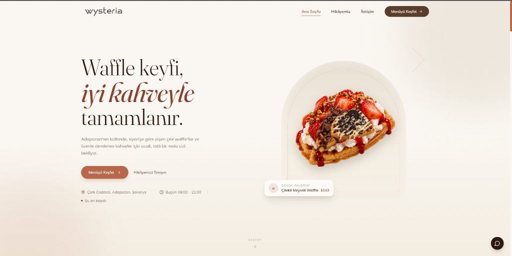
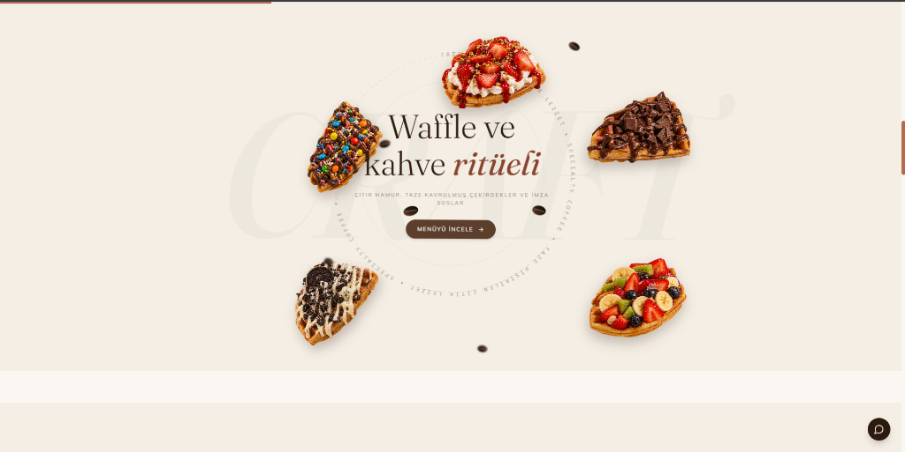
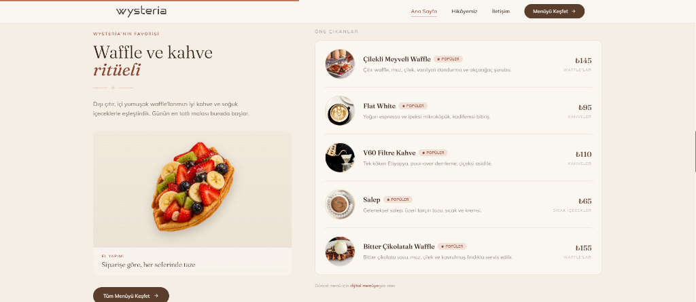

# Wysteria Works — Waffle & Coffee

Waffle ve kahve konseptli mekânlar için hazırlanmış tek sayfalık bir dijital vitrin çalışması. Karamel, süt köpüğü ve erimiş çikolata tonlarında sıcak bir zemin üzerine kurulu; amaç ziyaretçiye vitrinin arkasındaki ustalığı hissettirmek.

**Canlı önizleme:** https://wysteria-works-waffle-coffee.vercel.app/

## Konsept

Site, sıcak bir pastane vitrinini dijitale taşıyor: yuvarlak hatlı kartlar, yumuşak gölgeler ve kaydırmayla dağılan waffle parçalarından oluşan küçük bir mikro-hikâye. Menü net, fiyatlar okunaklı, iletişim tek dokunuş uzakta. Türkçe ve İngilizce içerik hazır.

## Bölümler

- **Hero** — sıcak tonlu karşılama sahnesi
- **Waffle ritüeli** — pin'lenmiş kaydırma sahnesi: tek parça görünen waffle dilimleri scroll ile dağılıyor, ortada yörünge halkası ve kahve çekirdekleriyle "Waffle ve kahve ritüeli" başlığı açılıyor
- **İmza ürünler** — fiyatlı satır listesi, üzerine gelindiğinde havalanan küçük görseller
- **Hikâye** — mekânın anlatıldığı editoryal blok
- **Galeri** — masaüstünde karşılıklı paralaks yapan yuvarlak kartlar
- **Ziyaret** — elle çizilmiş ada/sokak dokulu harita, çalışma saatleri ve yol tarifi
- **CTA & footer** — tek kesintisiz çikolata zemin; scroll ile yerine oturan waffle parçaları
- **Menü sayfası** — kategori pill'leri sıvı dolgu efektiyle doluyor; liste satırlarında fizik tabanlı hover

## Teknik yapı

React 18 · TypeScript · Vite · Tailwind CSS · GSAP + ScrollTrigger · Lenis pürüzsüz kaydırma · React Router · TR/EN dil desteği

Açılışta iki parçalı perde preloader var; `prefers-reduced-motion` tercihinde tüm koreografi sadeleşiyor, mobilde pin'li sahneler statik kompozisyona dönüyor.

## Not

Sitedeki ürün isimleri, fiyatlar ve görseller vitrin amaçlı temsilidir; mekânın kendi menüsü ve bilgileriyle güncellenmesi yeterlidir.
